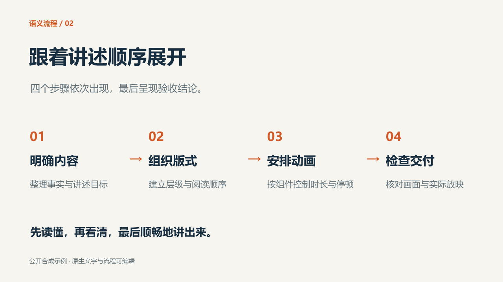

# AI 演示文稿工作流


<p align="center">
  <strong>从视觉方向，到可编辑交付</strong><br>
  面向 AI 代理的中文演示文稿工作流：图片式制作、原生重建与精编动画。
</p>

<p align="center">
  <a href="https://github.com/Chocologician/codex-ppt-refined-skill/actions/workflows/check.yml"></a>
  <a href="CHANGELOG.md"></a>
  <a href="LICENSE"></a>
  <a href="https://github.com/Chocologician/codex-ppt-refined-skill/issues"></a>
</p>

<p align="center">
  <a href="#快速开始">快速开始</a> ·
  <a href="#公开示例">公开示例</a> ·
  <a href="docs/快速开始.md">完整文档</a> ·
  <a href="CONTRIBUTING.md">参与贡献</a> ·
  <a href="CHANGELOG.md">版本记录</a>
</p>

这是供支持技能文件的 AI 代理使用的工作流技能，并附带可独立运行的辅助脚本。项目聚焦于“先理解内容，再建立视觉系统，最后完成可编辑交付”的完整链路；它不提供独立图形界面，也不是把任意图片一键转换成可编辑 PPT 的软件。

项目标识：`codex-ppt-refined-skill`；技能名称：`codex-ppt`。

> **当前版本：v0.4.0 · 公开预览版**
>
> 适合试用、贡献案例和验证工作流。自动检查已覆盖文档、来源清单、公开示例和 PowerShell 语法；桌面 PowerPoint 的实际放映仍需在目标机器上复核。

> 来源：图片式制作、生图任务管理、原有风格参考与组装脚本基于 [ningzimu/codex-ppt-skill](https://github.com/ningzimu/codex-ppt-skill)，原作者为 ningzimu。本项目增加原生重建与精编动画流程、辅助脚本和中文协作说明。原作者署名与 MIT 许可保留，详见[来源说明](NOTICE.md)。

## 公开示例

下面是仓库自带的三页合成示例。源稿、动画计划、静态图片和动画成品均可下载，内容不依赖私人资料。

<p align="center">
  
</p>

<p align="center">
  
</p>

[查看三页示例与重放说明](examples/public-demo/README.md) · [下载可编辑源稿](examples/public-demo/source.pptx) · [下载动画成品](examples/public-demo/animated.pptx)

这是原生排版与动画的功能演示，不是生图模型样片。它展示了可编辑组件、分步进入和可核对时序；不代表所有内容都会自动获得相同设计效果。示例页的结构、动画计划和核验结果都可以直接查看。

## 设计原则

| 原则 | 在项目中的体现 |
| --- | --- |
| **内容先行** | 先拆解受众、目标、证据和叙事节奏，再选择版式与视觉语言。 |
| **组件可编辑** | 关键文字、形状、连接线和动画保持为原生对象，便于修改与复用。 |
| **交付可核验** | 计划绑定源稿哈希，保存后重新读取时序，并对公开示例提供验证记录。 |
| **边界可追溯** | 上游文件、翻译整理、新增代码和公开示例分别登记，不混淆来源。 |

## 谁适合使用

- 希望让 AI 代理协助制作演示文稿的人。
- 已有PPT，需要整理组件、添加原生动画或调整节奏的人。
- 希望贡献风格、案例、工作流和检查工具的人。

由代理负责理解资料、判断版式、选择组件和编写计划；由脚本执行确定的操作；由使用者确认事实与最终效果。自动检查不能替代审美和内容判断。

## 能力边界

| 任务 | 由谁完成 | 当前状态 |
| --- | --- | --- |
| 资料到图片式PPT | 代理、生图工具、上游组装脚本 | 继承上游，取决于所选生图环境 |
| 参考稿到原生可编辑PPT | 代理及其原生演示文稿编辑工具 | 提供工作流，不包含独立转换引擎 |
| 组件分组与串行动画 | 代理编计划，PowerPoint脚本执行 | 已有公开三页示例，可本机重放 |
| 调整已有动画速度 | 代理结合目标应用调整 | 有方法说明，尚无专用调速命令 |
| 交互、并行、媒体、退出动画 | 需要另行实现 | 当前执行器不支持 |
| 自动检查 | 静态测试、合成稿、目标应用 | 各有覆盖范围，见[测试说明](docs/测试说明.md) |

## 快速开始

### 只想先验证能不能用

Windows 上安装桌面 Microsoft PowerPoint 和 PowerShell 7 后，在仓库根目录运行：

~~~powershell
./examples/public-demo/run_demo.ps1
~~~

脚本使用仓库自带源稿和计划，输出到新的构建目录，不需要图片接口或手填形状编号。打开输出的PPT，按 F5 放映：页内自动展开，讲完单击翻页。

没有上述环境时，可以直接查看页面图片和动图；这不等于完成本机原生放映验证。

### 从零制作自己的演示文稿

1. 将 skills/codex-ppt 整个文件夹复制到目标项目的 .agents/skills/codex-ppt，保留许可证和来源文件。
2. 确认代理能读取该技能，并具备所需生图或原生编辑工具；参考[环境兼容性](docs/环境兼容性.md)。
3. 提供资料、受众、页数与时长，使用下面的指令。也可先用[合成内容提纲](examples/public-demo/brief.md)练习。

~~~text
使用 codex-ppt，依据这些材料制作一份中文演示文稿。
先梳理内容结构并确定视觉方向；样张认可后继续全篇。
需要可编辑和动画时，先完成原生重建与逐页校准，再安排动画。
~~~

已有上游同名技能时先备份并选择版本，避免发现冲突。完整步骤、预期产物与常见问题见[快速开始](docs/快速开始.md)。

### 给已有PPT做动画

~~~text
使用 codex-ppt，为这份PPT编排原生动画，保留现有内容、字体和版式。
先按视觉组件建立计划，再生成候选稿并检查实际放映。
~~~

代理应先检查文件，再读取当前形状编号与源文件哈希。想直接操作脚本的开发者，阅读[动画延伸与命令说明](skills/codex-ppt/docs/editable-refined-animation.md)。不要把公开示例计划直接套到自己的文件。

## 环境与兼容性

| 操作 | 所需环境 | 是否调用外部图片接口 |
| --- | --- | --- |
| 浏览示例图片与动图 | 支持相应文件的浏览器 | 否 |
| 重放公开动画示例 | Windows、PowerShell 7、桌面 PowerPoint | 否 |
| 仓库静态检查 | Python 3.10及以上、开发依赖 | 否 |
| 图片生成 | 代理内置生图工具，或可用的图片服务 | 取决于所选后端，可能收费 |
| 原生可编辑重建 | 代理提供的原生演示文稿编辑能力 | 取决于所选工具 |

PowerPoint 网页版、WPS、macOS 与 Linux 的原生动画执行尚未作为已验证环境列入支持范围。通用技能格式可被其他代理读取，不等于全部工具与效果兼容。

图片式命令行操作使用[统一运行入口](docs/快速开始.md)，确保依赖安装和执行使用同一个解释器；不要求给原生动画示例安装图片依赖。

## 项目结构

```text
skills/codex-ppt/       技能入口、参考资料与执行脚本
examples/public-demo/   可下载、可重放的公开示例
docs/                   快速开始、架构、质量与发布文档
templates/              风格与案例贡献模板
tests/                  静态、来源和公开示例检查
.github/                CI、Issue 表单和 PR 模板
```

## 参与贡献

先从一个可验证的小问题开始，不必会写程序：

- [初次贡献任务](docs/初次贡献任务.md)：小范围任务、修改位置与验收方法。
- [风格模板](templates/风格贡献模板.md)：封面、正文和复杂页的视觉规则。
- [案例模板](templates/案例贡献模板.md)：公开或合成材料的成功与失败记录。
- [贡献指南](CONTRIBUTING.md)：代码、文档与来源登记。
- [视觉质量标准](docs/视觉质量标准.md)：同条件比较，而不是只说“更好看”。

问题反馈与功能提案使用仓库模板。新增默认行为、工具或依赖先讨论。维护约定见[维护说明](GOVERNANCE.md)，计划与未实现方向见[路线图](ROADMAP.md)。

参与协作请遵循[行为准则](CODE_OF_CONDUCT.md)，安全问题与敏感信息处理方式见[安全说明](SECURITY.md)。

## 本地检查

~~~shell
python -m pip install -r requirements-dev.txt
python -m unittest discover -s tests -v
~~~

Windows 本机的原生动画回归：

~~~powershell
./skills/codex-ppt/scripts/test_refined_animations.ps1
~~~

持续集成检查结构、来源、语法和公开示例；没有 PowerPoint 的运行器不会宣称完成桌面放映验证。详细覆盖范围见[测试说明](docs/测试说明.md)。

## 版本与发布

项目使用语义化版本号：

- **补丁版本**：修正文档、测试或兼容性问题；
- **次版本**：增加向后兼容的工作流、脚本或示例；
- **主版本**：改变技能入口、计划格式或使用方式。

发布前请阅读[发布与上游同步](docs/发布与上游同步.md)，完成测试、来源清单核对、示例验证和变更记录。正式版本会在 GitHub Releases 中保留可读的发布说明。

## 来源与许可

基础图片式流程来自 [ningzimu/codex-ppt-skill](https://github.com/ningzimu/codex-ppt-skill)。本项目保留原作者声明，新增部分同样按 [MIT 许可](LICENSE) 提供。

上游内容、翻译整理与新增代码的边界记录在[来源说明](NOTICE.md)和文件清单中。技术字段、命令及许可证保留准确标识或原文，公共说明以中文为主。

项目结构见[架构与扩展](docs/架构与扩展.md)，更新记录见[版本记录](CHANGELOG.md)。
